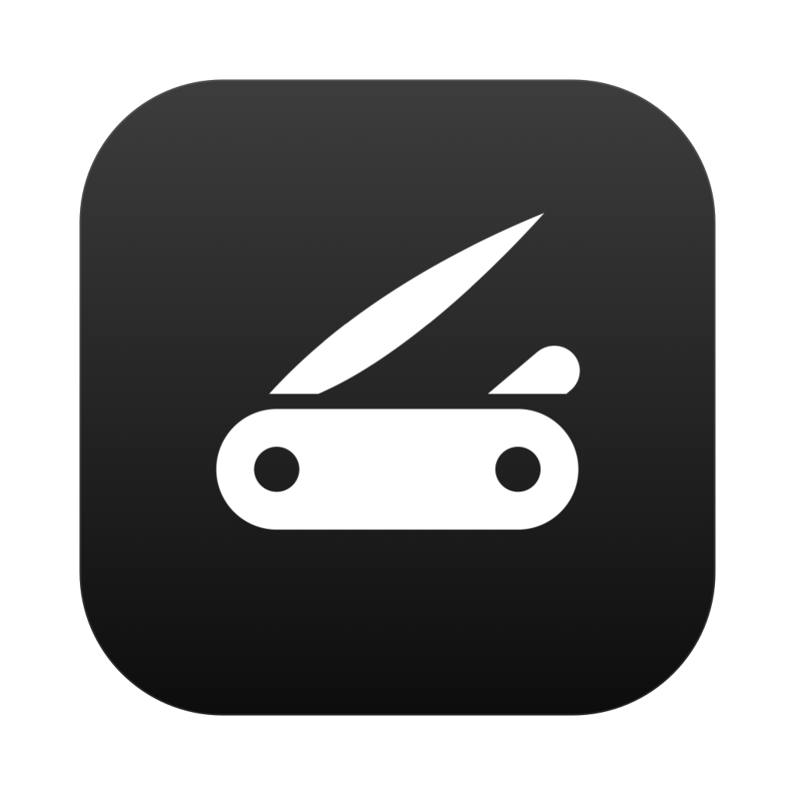

<p align="center">
  
</p>

<h1 align="center">Pocket</h1>

<p align="center">
  A pocket knife for your Mac: the everyday tools you'd otherwise install one by one, in one menu bar app.<br>
  Every feature is built in and stays idle until you switch it on.
</p>

<p align="center">
  <a href="https://github.com/byaydenrx/Pocket/releases/latest">Download</a> ·
  <a href="#features">Features</a> ·
  <a href="#build-it-yourself">Build</a> ·
  <a href="docs/ADDING_FEATURES.md">Add a feature</a> ·
  <a href="LICENSE">GPL-3.0</a>
</p>

## Features

**Windows and Dock**
- App and window switcher on ⌘Tab, with three layouts, previews, appearance delay, columns and instant selection.
- Click an app's Dock icon to cycle its windows. Dock previews.
- Quit apps when their last window closes, instantly or after a delay you choose.
- Quit and close protection: hold ⌘Q or ⌘W a moment so a slip doesn't close your work.

**Files**
- A shelf for files you are moving around. Drop images, videos, audio or PDFs on it and three tools appear for that type: convert, compress and upscale images; convert, compress and resize videos; convert, compress and change the speed of audio; merge, compress or split PDFs into images.
- Downloads: aria2 downloads, torrents and magnets, right in the menu panel ([aria2](https://formulae.brew.sh/formula/aria2) required).
- Storage Analyzer: what takes up space on each drive, folder by folder, with the largest files.
- Clean & Optimize: caches, logs, developer junk and app leftovers, plus upkeep tasks (flush DNS, reset Quick Look, rebuild Open With and Spotlight, free memory, Homebrew cleanup).

**System**
- Monitor: CPU, GPU, memory, temperatures, network (with Wi-Fi details, ping and a speed test), disks, battery, uptime and connected devices.
- Task Manager: your busiest apps with one-click quit. macOS's own processes are never listed.
- Display: resolutions (HiDPI included), refresh rates, brightness for every screen (DDC for external monitors), main display and mirroring.
- Per-app volume mixer and microphone mute.
- Keep Awake, a click away (right-click the icon).
- Quick Toggles: lock, sleep, screen saver, display off, eject disks, empty Trash, Dock auto-hide, clear clipboard and more.

**Extras**
- Menu Bar Timer with typed times ("25m focus", "3pm"), alarm tones and Pomodoro.
- Reminders in the panel and, optionally, the menu bar.
- Dock Now Playing: hover Music in the Dock for a card with controls.

## Make it yours

- Reorder, hide and rename the panel's tabs, and pin any Settings page to the panel as its own tab.
- Rename and reorder quick toggles; edit every section's contents.
- One Liquid Glass look across every surface, Clear or Tinted, with a darkness slider.
- Choose the menu bar icon, and change or remove every shortcut in one place.

## Light on your Mac

Features that are off cost nothing: they start no timers, taps or listeners. Monitors sample only while you look at them, aria2 stops a minute after your last download, and the Task Manager reads processes only while it is on screen.

## Install

Download `Pocket.dmg` from the [latest release](https://github.com/byaydenrx/Pocket/releases/latest), open it and drag Pocket to Applications. Pocket is not notarized, so the first time macOS blocks it: open **System Settings › Privacy & Security** and click **Open Anyway**. Updates install from inside the app and are checked against the project's signing key.

## Requirements

- A Mac with **Apple silicon** (M1 or later). Intel Macs are not supported.
- **macOS 14 Sonoma or later.** Liquid Glass surfaces need macOS 26; earlier versions get the standard frosted look.
- Nothing else for the core app: no Homebrew, no drivers, no accounts.

Optional tools, used only by the features that name them (Pocket tells you when one is missing):

| Feature | Needs | Install |
|---|---|---|
| Downloads | [aria2](https://aria2.github.io) | `brew install aria2` |
| Shelf: WebP output | cwebp | `brew install webp` |
| Shelf: best PNG compression | pngquant | `brew install pngquant` (falls back to built-in compression) |
| Shelf: MP3 output | lame | `brew install lame` |
| Optimize: Clean Up Homebrew | Homebrew | [brew.sh](https://brew.sh) (the task hides without it) |

Permissions are asked for only when a feature that needs them is turned on: Accessibility (switcher, Dock clicks, quit on close, Dock Now Playing), Screen Recording (switcher previews), Full Disk Access (Clean & Optimize, Storage Analyzer), Reminders, and Automation for Finder and Music.

## Build it yourself

```bash
git clone https://github.com/byaydenrx/Pocket.git
cd Pocket
./build.sh --install
```

Full Xcode is recommended (`DEVELOPER_DIR=/Applications/Xcode.app/Contents/Developer ./build.sh`). `--install` also creates a local self-signed identity so macOS keeps Pocket's permissions across rebuilds.

## Credits

Pocket began as a fork of [Vorssaint](https://github.com/vorssaint/vorssaint-utils) by Vorssaint (GPL-3.0-or-later) and grew from there; see [NOTICE.md](NOTICE.md). The menu bar timer, Dock Now Playing card, Downloads and shelf image tools come from the author's earlier apps Tick, Encore, Fetch and Tack.

## License

[GPL-3.0-or-later](LICENSE).
